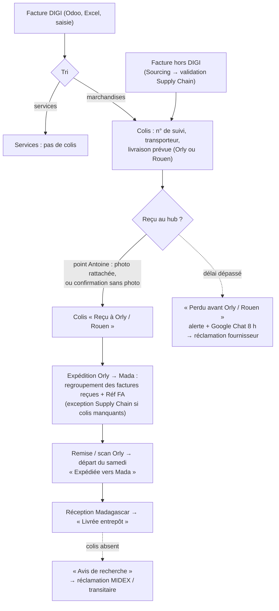

# 📦 Shipment Manager — Supply Chain Control Tower

Application interne de suivi des imports (aérien et maritime) vers Madagascar.
Elle remplace progressivement le fichier Excel **RECEP_IMPORT** : réceptions
fournisseurs à Orly, départs vers Madagascar, conteneurs maritimes, alertes et
relances.

> Ce document décrit **l'application telle qu'elle est dans le code** (branche
> `main`). Les évolutions prévues sont listées à part, dans la section
> [Feuille de route](#12-feuille-de-route).

---

## Sommaire

1. [Architecture](#1-architecture)
2. [Rôles et droits](#2-rôles-et-droits)
3. [Écrans](#3-écrans)
4. [Flux de travail : du fournisseur à Madagascar](#4-flux-de-travail--du-fournisseur-à-madagascar)
5. [Statuts : qui les change et quand](#5-statuts--qui-les-change-et-quand)
6. [Alertes](#6-alertes)
7. [Suivi transporteur](#7-suivi-transporteur)
   - [Factures fournisseurs (DIGI LOGISTIC et hors DIGI)](#7-bis-factures-fournisseurs-digi-logistic-et-hors-digi)
   - [Point Antoine et photos](#7-ter-point-antoine-et-photos)
8. [Ce qui est automatique et ce qui est manuel](#8-ce-qui-est-automatique-et-ce-qui-est-manuel)
9. [Points d'attention connus](#9-points-dattention-connus)
10. [Données, API et sécurité](#10-données-api-et-sécurité)
11. [Installation, configuration et déploiement](#11-installation-configuration-et-déploiement)
12. [Feuille de route](#12-feuille-de-route)
13. [Historique des évolutions](#13-historique-des-évolutions)

---

## 1. Architecture

```text
Navigateur (React 19 + Vite + TypeScript + Tailwind)
        │  fetch(..., credentials: 'include')  — cookie de session HttpOnly
        ▼
API Express (src/serverApp.ts)
  • en local : server.ts (port 3000)
  • en production : Vercel Serverless (api/index.ts)
        │
        ├── Neon PostgreSQL ........ source de vérité de toutes les données métier
        ├── Gemini (@google/genai) .. assistant IA, appelé uniquement côté serveur
        ├── Google Chat ............ relances par webhook (URL fixée côté serveur)
        └── Vercel Cron ............ rafraîchissement quotidien du suivi transporteur
```

Principes :

- **Neon est la seule source de vérité.** Le navigateur n'enregistre rien
  d'autre que le thème clair/sombre (`localStorage.shipment_manager_theme`).
- **Aucun secret côté navigateur.** Aucune variable `VITE_*` sensible ; Gemini,
  Neon et Google Chat ne sont appelés que par le serveur.
- **Aucune donnée inventée.** Pas de suivi simulé, pas de valeur métier
  pré-remplie ; une information inconnue reste vide.

---

## 2. Rôles et droits

Trois rôles. Le serveur fait foi : masquer un bouton ne remplace jamais le
contrôle côté API.

| Action | SUPPLY_CHAIN | SOURCING | DIRECTION |
|---|:---:|:---:|:---:|
| Consulter le tableau de bord, utiliser l'assistant IA | ✅ | ✅ | ✅ |
| Voir les suivis Aérien / Maritime (colis et expéditions), les fiches et les photos | ✅ | ✅ | ✅ |
| Factures fournisseurs : consulter, synchroniser Odoo, importer Excel, saisir une facture DIGI | ✅ | ✅ | ❌ |
| Trier une facture DIGI (marchandises / services), ajouter ou modifier un colis | ✅ | ✅ | ❌ |
| Saisir une facture hors DIGI | ✅ (validée d'office) | ✅ (à valider) | ❌ |
| Valider ou refuser une facture hors DIGI ; modifier une facture hors DIGI validée | ✅ | ❌ | ❌ |
| Supprimer une facture | ✅ | ❌ | ❌ |
| Point Antoine / réception Rouen : photos, rattachement, confirmation de réception | ✅ | ❌ | ❌ |
| Colis : reçu, perdu, avis de recherche, remettre à recevoir ; retirer un colis déjà traité | ✅ | ❌ | ❌ |
| Créer une expédition (regroupement), ajouter / retirer des factures, forcer l'exception « colis pas tous reçus » | ✅ | ❌ | ❌ |
| Modifier les champs d'une expédition (dates, LTA / BL, statut…) | ✅ | ✅ | ❌ |
| Supprimer une expédition | ✅ | ❌ | ❌ |
| Ajouter un transporteur à la liste | ✅ | ❌ | ❌ |
| Ajouter un fournisseur à la liste | ✅ | ✅ | ❌ |
| Numéros de suivi et événements des expéditions (ajout, correction) | ✅ | ✅ | ❌ |
| Voir et résoudre / réactiver les alertes | ✅ | ✅ | ❌ |
| Envoyer une relance Google Chat | ✅ | ✅ | ❌ |
| Synchroniser le suivi d'une expédition | ✅ | ✅ | ❌ |
| Synchroniser tout le suivi | ✅ | ❌ | ❌ |
| Analyses & SLAs (onglet du tableau de bord) | ✅ | ❌ | ✅ |
| Paramètres : utilisateurs, transporteurs, intégrations (dont taux USD et délais d'alerte), base, purge | ✅ | ❌ | ❌ |
| Changer son propre mot de passe (profil) | ✅ | ✅ | ✅ |
| Réinitialiser le mot de passe d'un autre utilisateur | ✅ | ❌ | ❌ |

Protections sur les comptes :

- on ne peut ni se désactiver soi-même, ni retirer son propre rôle SUPPLY_CHAIN ;
- le **dernier compte SUPPLY_CHAIN actif** ne peut être ni rétrogradé ni désactivé ;
- un compte désactivé perd immédiatement ses sessions.

---

## 3. Écrans

| Menu | Rôles | Contenu |
|---|---|---|
| Tableau de bord & KPI | tous | Onglet « Vue d'ensemble » : indicateurs, alertes critiques, dernières expéditions mises à jour, actions rapides. Onglet « Analyses & SLAs » (SC, Direction) : respect des SLAs par transporteur, top fournisseurs, délai moyen de transit |
| Suivi Aérien | tous (Direction en lecture) | Onglet **Colis vers Orly** (colis fournisseur → Orly : à recevoir, reçus, perdus, avis de recherche ; point Antoine ; factures sans colis) puis onglet **Expéditions Orly → Mada** (liste, filtres, édition directe, export CSV, réclamation) |
| Suivi Maritime | tous (Direction en lecture) | Onglet **Colis vers Rouen** puis onglet **Expéditions Rouen → Mada** |
| Factures fournisseurs | SC, Sourcing | Factures DIGI LOGISTIC → NextHope et factures hors DIGI, en 4 onglets : À trier, Marchandises (suivi colis), Services, Hors DIGI à valider (voir §7 bis) |
| Centre d'Alertes | SC, Sourcing | Alertes des expéditions et des colis, message de relance pré-rédigé, envoi Google Chat, résolution partagée |
| Paramètres | SC | **Utilisateurs & accès** ; **Transporteurs** (créer, renommer, changer le mode, relier à un connecteur de suivi, désactiver) ; **Intégrations** (suivi des colis : taux USD → EUR et délais d'alerte ; N8N & webhook Google Chat ; liens Google Sheets ; seuils) ; **Base de données** |

La barre de recherche du haut cherche dans les deux onglets d'un suivi ; chaque
onglet affiche son nombre de résultats.

En plus des menus :

- **Shipment AI** : bulle de chat en bas à droite, disponible sur tous les écrans.
  La conversation est conservée en changeant d'écran. Limité à 40 requêtes par
  heure et par utilisateur.
- **Profil** (nom en haut à droite) : changer son mot de passe (12 caractères
  minimum, les autres sessions sont déconnectées), basculer le thème clair /
  sombre, se déconnecter.
- **Valeur (€)** d'une expédition : total de ses factures. Facture DIGI = total
  de ses lignes (services compris) ; facture hors DIGI = son montant, l'USD étant
  converti avec le taux de Paramètres (ignoré tant que le taux n'est pas saisi).
  Pour une ancienne expédition sans facture : la facture DIGI de même référence,
  sinon la « Valeur marchandise » saisie (`cost_eur`).
- **Connecteur de suivi** : chaque transporteur de la liste peut être relié à
  un connecteur (DHL, FedEx, UPS…) dans Paramètres › Transporteurs. Il sert à
  reconnaître le transporteur d'un colis à partir du format de son n° de suivi.

**Fiche expédition** (clic sur une ligne) : informations principales
(transporteur, LTA — ou BL et conteneur —, ETA, valeur), suivi transporteur,
**factures et colis** de l'expédition (ajout / retrait de factures, « Absent à
l'arrivée » sur un colis), suivi Orly → Madagascar (statut, remise / scan
Orly, départ et ETA Mada calculés, réception Mada, Réf FA, douane, remarques),
délais ETD / ETA, historique, documents. Une expédition de l'ancien modèle
encore en préparation affiche un bandeau « à revoir ».

---

## 4. Flux de travail : du fournisseur à Madagascar

### 4.1 Vue d'ensemble

Trois objets :

- la **facture** fournisseur (DIGI ou hors DIGI) ;
- le **colis** : un n° de suivi, livré à Orly (aérien) ou au quai de Rouen
  (maritime). Une facture peut avoir plusieurs colis ; un colis peut couvrir
  plusieurs factures du même fournisseur ;
- l'**expédition** Orly / Rouen → Madagascar : **une facture de vente (Réf FA
  DIGI-NXT)** qui regroupe les factures reçues au hub.



### 4.2 Qui fait quoi, étape par étape

| # | Étape | Qui | Où | Manuel / auto |
|---|---|---|---|---|
| 1 | Les factures DIGI arrivent (Odoo chaque jour vers 8 h et à la demande, import Excel, saisie) dans « À trier » | — | Factures fournisseurs | **Auto** (Odoo) ou manuel |
| 2 | Trier chaque facture DIGI : **Marchandises** (suivi des colis) ou **Services** (pas de colis) ; badge « Tri en retard » et alerte après 3 jours | Sourcing / Supply Chain | Factures fournisseurs | **Manuel** (frais DEEE / RCP / FRDP seuls : services d'office) |
| 3 | Saisir une facture **hors DIGI** (fournisseur, réf., date, montant + devise, acheteur) | Sourcing (à valider) ou Supply Chain | Factures fournisseurs › « Facture hors DIGI » | **Manuel** |
| 4 | Valider ou refuser (avec motif) les factures hors DIGI | Supply Chain | Onglet « Hors DIGI à valider » | **Manuel** |
| 5 | Ajouter les **colis** : n° de suivi, transporteur (liste de Paramètres, ou reconnu d'après le n°), livraison prévue, destination Orly / Rouen | Sourcing / Supply Chain | « + Colis » sur une facture ou une sélection d'un même fournisseur | **Manuel** ; un n° déjà connu rattache la facture au colis existant |
| 6 | **Point Antoine** : déposer toutes les photos du point, puis les rattacher une à une (n° lu sur l'étiquette ; n° inconnu ou illisible → choisir les factures, le colis est créé). Rattacher confirme la réception à la date du point | Supply Chain | Suivi Aérien › Colis vers Orly › « Point Antoine (photos) » | **Manuel** ; passage automatique à la photo suivante |
| 7 | Colis confirmés sans photo : cocher et « Confirmer la réception » ; colis non annoncé : « Colis reçu non annoncé » | Supply Chain | Colis vers Orly / Rouen | **Manuel** |
| 8 | Colis non confirmé à temps → « Perdu avant Orly / Rouen », alerte avec réclamation, récapitulatif Google Chat | — | Centre d'Alertes, Google Chat | **Auto** (au chargement et chaque jour à 8 h) |
| 9 | Créer l'**expédition** : cocher les factures reçues de la semaine, saisir la Réf FA (et LTA / BL, transitaire) ; facture pas entièrement reçue → exception à confirmer, inscrite dans l'historique | Supply Chain | « Nouvelle expédition » | **Manuel** |
| 10 | Saisir la remise / le scan à Orly (aérien) ou l'ETD (maritime) | Supply Chain | Liste ou fiche | **Manuel** ; départ du samedi, ETA Mada et statut « Expédiée vers Mada » **auto** |
| 11 | Réception à Madagascar : date de réception ; colis manquant → « Absent à l'arrivée » | Supply Chain | Fiche expédition | Date **manuelle** ; « Livrée entrepôt » **auto** ; avis de recherche **manuel** |
| 12 | Traiter les alertes : relancer, puis « Résolu » | Supply Chain / Sourcing | Centre d'Alertes | Alertes **auto** ; relance et résolution **manuelles** |

---

## 5. Statuts : qui les change et quand

| Objet | Statuts | Quand | Manuel / auto |
|---|---|---|---|
| **Facture DIGI** (tri) | À trier · Marchandises · Services | À l'arrivée : À trier | **Manuel** ; services d'office si la facture ne contient que des frais |
| **Facture hors DIGI** (validation) | À valider · Validée · Refusée (motif) | Saisie par Sourcing : À valider ; par Supply Chain : Validée ; refusée puis corrigée : de nouveau À valider | **Manuel** (Supply Chain) |
| **Facture** (réception) | Sans colis · x / n colis reçus · Reçue à Orly | Dès que tous ses colis sont reçus | **Auto** |
| **Colis** | À recevoir · Reçu à Orly / Rouen · Perdu avant Orly / Rouen · Avis de recherche | Reçu : point Antoine ou confirmation. Perdu : délai dépassé (livraison prévue + 7 j, sinon date de facture + 14 j, réglables). Avis de recherche : reçu au hub mais absent à l'arrivée à Madagascar | Reçu, avis de recherche : **manuels** ; perdu : **auto** (ou déclaré à la main) |
| **Expédition** | En préparation · Expédiée vers Mada · Bloquée douane · Livrée entrepôt | Création : En préparation. Expédiée : dès que la remise / scan Orly (aérien) ou l'ETD (maritime) est saisi. Livrée : dès que la date de réception Mada est saisie | **Auto** sur ces dates ; Bloquée douane **manuel** |
| Départ Madagascar | date ou « Non parti » | Samedi qui suit la remise / scan Orly | **Auto** |
| ETA Mada (semaine du) | date ou « Non parti » | Remise lundi–jeudi → lundi suivant ; vendredi–dimanche → lundi de la 2ᵉ semaine | **Auto** |
| Statut douane, priorité | Non Requis · En cours · Dédouané · Bloqué Douane ; Haute · Moyenne · Basse | Fiche expédition | **Manuel** |
| Statut de chaque n° de suivi d'expédition | Aucune information · Informations reçues · En transit · En cours de livraison · Livré · Incident | Événement le plus récent | **Auto** |
| Alerte résolue | oui / non | Après traitement | **Manuel**, partagé |

Les statuts d'expédition d'avant ce modèle (Attente confirmation transitaire,
En livraison vers Orly, Reçu et expédié, Perdu Orly…) ont été convertis une
fois et restent consultables (`legacy_global_status`). Les expéditions qui
n'étaient pas parties sont marquées « à revoir » : regrouper leurs factures
dans une expédition de la semaine, puis les supprimer (l'application le
propose quand une expédition n'a plus de facture).

---

## 6. Alertes

Les alertes sont **recalculées automatiquement** à chaque chargement, à partir
des données (`src/lib/rulesEngine.ts` pour les expéditions,
`src/lib/parcelAlerts.ts` pour les colis et les factures). Leur **résolution**
est manuelle et **partagée**.

| Règle | Déclenchement | Gravité |
|---|---|---|
| R0 — Expédition à revoir | Expédition de l'ancien modèle encore en préparation | Avertissement |
| R1 — Expédition en attente de départ | Expédition aérienne « En préparation » depuis 10 jours ou plus (hors « à revoir ») | Critique |
| R3 — Blocage douane | Statut douane = Bloqué Douane, ou expédition « Bloquée douane » | Critique |
| R4 — ETA dépassée | ETA passée, expédition pas livrée, sans statut transporteur « Delivered » | Avertissement |
| R6 — Colis non reçu au hub | Colis « Perdu avant Orly / Rouen » → réclamation au fournisseur (message prêt) ; annoncé une fois sur Google Chat dans le récapitulatif de 8 h | Critique |
| R7 — Avis de recherche | Colis reçu au hub mais absent à l'arrivée → réclamation MIDEX (aérien) ou transitaire (maritime), photo de réception mentionnée | Critique |
| R8 — Facture DIGI à trier | Facture DIGI non triée 3 jours après son arrivée (délai réglable) | Avertissement |

Chaque alerte propose un **message de relance** prêt à copier ou à envoyer sur
Google Chat. Les résolutions et réactivations sont tracées dans le journal
d'audit.

---

## 7. Suivi transporteur

Pour chaque expédition, la fiche contient un panneau **Suivi transporteur** :

- **plusieurs numéros par expédition**, stockés en texte (plus de chiffres
  perdus comme dans Excel) ;
- **détection automatique du transporteur** d'après le format du numéro
  (Amazon `FR…`, UPS `1Z…`, Colissimo `6A…`, Chronopost `X…FR`, etc.),
  toujours corrigeable à la main ; un format ambigu reste « Non identifié » ;
- **signalements** : référence de bon de livraison fournisseur (« BL … »)
  saisie à la place d'un numéro de suivi, numéro tronqué par Excel ;
- **historique d'événements** par numéro, avec leur source (saisie manuelle,
  API transporteur, rapport Amazon…) et l'auteur de la saisie ;
- le **statut du numéro** suit toujours l'événement le plus récent.

**Automatisation.** L'application sait interroger des « fournisseurs de
suivi » (un par transporteur), mais **aucun n'est encore branché** : tout le
suivi est donc manuel pour l'instant. Branchements prévus, tous gratuits :
rapport d'expéditions Amazon Business, API La Poste (Colissimo et Chronopost),
UPS, DHL et FedEx. Une fois un fournisseur branché :

- un **cron quotidien** (limite du plan Vercel Hobby : une fois par jour) met
  à jour les numéros actifs non livrés ;
- le bouton **Synchroniser** apparaît dans la fiche ;
- en cas d'échec du transporteur, **l'ancien suivi est conservé** et l'erreur
  est affichée. Rien n'est jamais simulé.

---

## 7 bis. Factures fournisseurs (DIGI LOGISTIC et hors DIGI)

Le menu « Factures fournisseurs » liste les factures de la base Odoo **DIGI
LOGISTIC** dont l'**entité de destination est NextHope** (avec leurs lignes de
produits) et les **factures hors DIGI** saisies à la main.

| Donnée | Champ Odoo (`account.move`) |
|---|---|
| Fournisseur | `partner_id` |
| Entité de destination | `dest_partner_id` |
| Référence de la facture | `ref` |
| Date de facturation | `invoice_date` |
| Commande AMAZON | `num_cmd_amz` |
| Facture vente | `sale_move_id` |
| Lignes : libellé, quantité, prix, sous-total | `invoice_line_ids` → `name`, `quantity`, `price_unit`, `price_subtotal` |

Trois façons d'alimenter la liste :

1. **Synchronisation Odoo**, automatique **chaque jour** (cron Vercel
   `/api/cron/sync-digi-invoices`, vers 5 h UTC soit 8 h à Madagascar, à ±59 min
   près sur le plan Hobby) et **à la demande** avec le bouton « Synchroniser
   Odoo ». Conditions :
   - `dest_partner_id` = `ODOO_DEST_PARTNER_ID` si renseigné, sinon nom de
     l'entité contenant `ODOO_DEST_PARTNER_NAME` (« NextHope » par défaut) ;
   - factures **brouillon incluses** (badge « Brouillon ») ;
   - factures **annulées exclues** : une facture annulée dans Odoo après avoir
     été synchronisée est retirée de la liste.

   L'écran affiche la date, l'origine (automatique ou utilisateur) et le
   résultat de la dernière synchronisation, y compris en cas d'échec.
   - Seules les factures modifiées dans Odoo depuis la dernière
     synchronisation sont relues (`write_date`) ; une synchronisation trop
     longue s'arrête proprement et indique combien de factures restent.
   - Les lignes de section et de note sont ignorées ; un libellé vide prend le
     nom du produit.
   - Une facture Odoo est **en lecture seule** dans l'application : elle se
     corrige dans Odoo puis se resynchronise.
   - Une facture qui n'est plus renvoyée par Odoo est marquée « Absente
     d'Odoo », jamais supprimée automatiquement.
   - Si une facture saisie à la main ou importée existe déjà (même fournisseur
     et même référence), elle est **rattachée** à la facture Odoo au lieu
     d'être dupliquée : Odoo devient sa source.
2. **Import Excel** (`.xlsx` ou `.csv`, première feuille) : en-têtes reconnus
   en libellés Odoo (« Fournisseur », « Référence », « Lignes de
   facture/Libellé »…) ou en noms techniques (`partner_id`, `ref`,
   `invoice_line_ids/name`…). Format export Odoo (champs de la facture sur sa
   première ligne seulement) ou tableau à plat. Aperçu avant import ; une
   facture dont une ligne est illisible n'est pas importée ; si la colonne
   « Entité de destination » est présente, seules les factures NextHope sont
   retenues ; si la colonne « État » est présente, les factures annulées sont
   ignorées ; une facture déjà connue n'est jamais écrasée.
3. **Saisie manuelle**, avec ses lignes ; modifiable ensuite.

**Lignes de frais.** Les lignes dont le code produit est `[DEEE]`, `[RCP]` ou
`[FRDP]` (frais de port) ne sont pas des articles à suivre : elles sont
fusionnées en une seule ligne « [SERVICES] … — services, non expédiés »
(quantité 1, prix = somme des frais), quelle que soit la source. Le total de
la facture reste égal au total Odoo.

**Tri des factures DIGI.** Aucune expédition ni aucun colis n'est créé
automatiquement, car les factures importées contiennent aussi des services.
Chaque nouvelle facture arrive dans **« À trier »** ; on la classe en
**Marchandises** (ses colis sont suivis, avec alertes de perte) ou en
**Services** (pas de colis), à l'unité ou en sélection multiple. Une facture
qui ne contient que des frais [DEEE], [RCP], [FRDP] est en services d'office.
Une facture non triée après 3 jours (réglable) porte le badge « Tri en
retard » et lève une alerte.

**Factures hors DIGI.** Factures fournisseur qui ne passent pas par DIGI
LOGISTIC mais doivent être suivies : fournisseur, référence, date, montant et
devise (EUR ou USD), acheteur / demandeur, sans lignes d'articles. Saisies par
le Sourcing, elles sont **« À valider »** jusqu'à la décision de la Supply
Chain (validée, ou refusée avec un motif ; corrigée, elle repart en
validation). Avant validation, leurs colis peuvent déjà être suivis, mais elles
ne peuvent pas entrer dans une expédition. Saisies par la Supply Chain, elles
sont validées d'office. Ce sont des marchandises d'office.

**Colis.** « + Colis » sur une facture, ou sur une sélection de factures d'un
même fournisseur : n° de suivi (facultatif), transporteur choisi dans
Paramètres › Transporteurs (ou reconnu d'après le format du n°), livraison
prévue, destination **Orly (aérien)** ou **Rouen (maritime)** — avec, pour
Rouen, type de livraison, colisage, volume et description. Un n° déjà connu
rattache la facture au colis existant. La colonne **Colis** indique « Sans
colis », « x / n reçu(s) » ou « Reçue à Orly ». La réception se confirme dans
Suivi Aérien / Maritime (voir §4).

**Valeur.** Total des factures de l'expédition : lignes (services compris) pour
DIGI, montant pour hors DIGI (USD converti avec le taux de Paramètres).

**Fournisseur AMAZON.** Toute facture qui porte un n° de commande Amazon a
pour fournisseur **AMAZON**, quel que soit le vendeur (Amazon ou vendeur
marketplace). Le vendeur réel reste enregistré et affiché (« Vendeur : … ») ;
il sert toujours à repérer les doublons (même vendeur et même référence).

**Affichage.** Factures groupées par fournisseur (sous-total, nombre de
factures sans colis, groupe repliable). Filtres : recherche libre, fournisseur,
source et, dans « Marchandises », état des colis (sans colis, pas tous reçus,
reçue).

**Sélection multiple.** Cases à cocher par facture, par fournisseur et pour la
liste affichée : Marchandises, Services, Remettre à trier, Ajouter un colis,
Valider / Refuser (hors DIGI, Supply Chain), Supprimer (Supply Chain ; pas les
factures encore présentes dans Odoo). Les échecs sont listés avec la raison.

Toutes ces actions sont tracées dans le journal d'audit.

---

## 7 ter. Point Antoine et photos

- **Point** : une date (Orly : point avec Antoine ; Rouen : réception au quai).
  Toutes les photos du point sont déposées d'un coup (sélection multiple ou
  glisser-déposer), réduites à 1 600 px dans le navigateur.
- **Rapprochement** photo par photo (◀ ▶, flèches du clavier, vignettes) : le
  n° lu sur l'étiquette retrouve le colis (Entrée pour rattacher) ; n° inconnu
  ou illisible → fournisseur et factures, le colis est créé. Rattacher confirme
  la réception à la date du point et passe à la photo suivante. « Passer »,
  « Supprimer la photo », « Détacher » (le colis reste reçu).
- **Stockage** : **Google Drive partagé** (Google Workspace), un dossier par
  point. L'application utilise un compte de service membre « Gestionnaire de
  contenu » du Drive partagé (un compte de service n'a pas d'espace propre :
  un dossier « Mon Drive » ne fonctionne pas). La photo passe par l'API qui la
  dépose dans Drive ; la base ne garde que l'identifiant du fichier. Affichage
  par `/api/photos/:id`, réservé aux utilisateurs connectés. Supprimer une
  photo la met à la corbeille du Drive partagé (récupérable 30 jours). Un colis
  supprimé rend ses photos « à rattacher » dans le point.

## 8. Ce qui est automatique et ce qui est manuel

**Automatique**

- Récupération quotidienne des factures DIGI → NextHope depuis Odoo (8 h, Madagascar), et à la demande.
- Fusion des lignes de frais DEEE / RCP / FRDP ; facture ne contenant que des frais classée en services.
- Reconnaissance du transporteur d'un colis d'après le format du n° de suivi.
- État de réception d'une facture à partir de ses colis.
- Passage des colis en retard à « Perdu avant Orly / Rouen » (au chargement et chaque jour à 8 h), récapitulatif Google Chat des nouvelles pertes.
- Départ du samedi et ETA Mada à partir de la remise / scan Orly ; statuts « Expédiée vers Mada » et « Livrée entrepôt » à partir des dates.
- Valeur d'une expédition à partir de ses factures (USD converti).
- Alertes, indicateurs, journal d'audit.

**Manuel**

- Tri des factures DIGI ; saisie et validation des factures hors DIGI.
- Ajout des colis (n° de suivi, livraison prévue).
- Point Antoine : photos et rattachement ; confirmations sans photo.
- Création des expéditions (regroupement, Réf FA), exceptions, dates de remise / départ et de réception Mada.
- Avis de recherche à l'arrivée ; relances et résolution des alertes.

**Pas encore disponible**

- Synchronisation Google Sheets (bouton retiré : elle n'existait qu'en simulation).
- Stockage réel des documents d'expédition (les documents ne sont que des métadonnées).
- Suivi automatique des colis par les transporteurs ; intégrations Amazon Business, MIDEX.

---

## 9. Points d'attention connus

1. **Le suivi transporteur des expéditions n'alimente pas encore les alertes.**
   La règle « ETA dépassée » lit l'ancien champ unique de statut transporteur.
2. **Perte détectée à 8 h ou à l'ouverture de l'application.** Remettre « à
   recevoir » un colis dont le délai est dépassé ne tient pas : il repasse
   « perdu » au contrôle suivant, sauf si sa livraison prévue est corrigée.
3. **Photos** : la taille est limitée à 4 Mo par photo (compressées, elles en
   font quelques centaines de Ko) ; les fichiers d'un point supprimé du Drive
   à la main ne s'affichent plus.
4. Le statut « Déjà reçu Mada, à refacturer (REGUL) » du fichier Excel n'existe
   pas encore dans l'application.
5. Les anciennes lignes « livraisons Rouen » des expéditions maritimes sont
   reprises en colis vers Rouen ; le tableau reste visible en lecture seule.

---

## 10. Données, API et sécurité

### Tables Neon

| Table | Contenu |
|---|---|
| `shipments` | Expéditions Orly / Rouen → Mada (`ref_fa_digi_nxt` = facture de vente ; `legacy_global_status`, `needs_review` pour l'ancien modèle) |
| `digi_invoices`, `digi_invoice_lines` | Factures DIGI (Odoo, Excel, saisie) et hors DIGI (`is_digi = false`, montant, devise, acheteur, validation) ; tri `triage` ; `shipment_id` = expédition |
| `parcels`, `parcel_invoices` | Colis (n° de suivi, transporteur, destination Orly / Rouen, statut, réception, `loss_notified_at`) et leurs factures |
| `parcel_photos`, `reception_points` | Photos (identifiant du fichier Google Drive) et points Antoine / réception Rouen (dossier Drive) |
| `app_settings` | Taux USD → EUR et délais d'alerte |
| `shipment_carriers`, `shipment_suppliers` | Listes de référence |
| `shipment_tracking_numbers`, `shipment_tracking_events` | Numéros de suivi des expéditions et historique |
| `resolved_alerts` | Alertes résolues (état partagé) |
| `digi_odoo_sync_runs` | Historique des synchronisations Odoo |
| `users`, `user_sessions` | Comptes et sessions (jeton haché en SHA-256) |
| `system_audit_logs` | Journal d'audit |
| `api_rate_limits` | Compteurs de limitation (connexion, IA) |
| `app_migrations` | Conversions ponctuelles déjà appliquées (`parcel_model_v1`, `parcel_rouen_v1`, `parcel_loss_notified_v1`…) |

Les tables sont créées automatiquement au premier usage (`CREATE TABLE IF NOT
EXISTS`) ; aucune migration manuelle n'est nécessaire.

### API principales

| Méthode et route | Rôle requis |
|---|---|
| `POST /api/auth/login`, `GET /api/auth/me`, `POST /api/auth/logout` | public / session |
| `GET /api/health` | public |
| `GET /api/shipments`, `GET /api/shipments/:id`, `GET /api/shipments/:id/digi-invoices`, `GET /api/shipments/:id/parcels` | connecté |
| `POST /api/shipments/from-invoices`, `POST /api/shipments/:id/invoices`, `DELETE /api/shipments/:id/invoices/:invoiceId` | SC |
| `PUT /api/shipments/:id` | SC, Sourcing |
| `DELETE /api/shipments/:id`, `POST /api/shipments/clear-all` | SC |
| `GET /api/digi-invoices`, `GET /api/digi-invoices/config`, `POST` / `PUT /api/digi-invoices[/:id]`, `POST /api/digi-invoices/import`, `POST /api/digi-invoices/sync-odoo`, `PATCH /api/digi-invoices/:id/triage`, `POST` / `PUT /api/digi-invoices[/:id]/direct` | SC, Sourcing |
| `PATCH /api/digi-invoices/:id/validation`, `DELETE /api/digi-invoices/:id` | SC |
| `GET /api/parcels`, `GET /api/digi-invoices/:id/parcels`, `GET /api/parcels/:id/photos`, `GET /api/photos/:photoId` | connecté |
| `POST /api/parcels`, `PUT /api/parcels/:id`, `DELETE /api/parcels/:id/invoices/:invoiceId` | SC, Sourcing |
| `PATCH /api/parcels/:id/status`, `DELETE /api/parcels/:id/photos/:photoId` | SC |
| `GET /api/reception-points`, `GET /api/reception-points/:id` | connecté |
| `POST /api/reception-points`, `POST /api/reception-points/:id/photos` (image), `PATCH` / `DELETE /api/reception-points/:id/photos/:photoId` | SC |
| `GET /api/settings/tracking` ; `PUT /api/settings/tracking` | connecté ; SC |
| `GET` / `POST /api/reference/carriers`, `/api/reference/suppliers` | lecture : connecté ; création : SC (transporteurs), SC et Sourcing (fournisseurs) |
| `GET /api/shipments/:id/tracking`, `POST /api/shipments/:id/tracking-numbers`, `PATCH` / `DELETE /api/tracking-numbers/:id`, `POST /api/tracking-numbers/:id/events`, `POST /api/tracking/sync/:shipmentId` | SC, Sourcing |
| `POST /api/tracking/sync-all` | SC |
| `GET /api/cron/update-tracking`, `GET /api/cron/sync-digi-invoices` (factures Odoo + colis perdus) | Vercel Cron (`Authorization: Bearer CRON_SECRET`) |
| `GET /api/alerts/resolved`, `POST` / `DELETE /api/alerts/:alertId/resolve` | lecture : connecté ; action : SC, Sourcing |
| `POST /api/google-chat-webhook` | SC, Sourcing |
| `POST /api/chat`, `POST /api/analyze-shipments` | connecté (40 requêtes par heure) |
| `/api/admin/users…`, `/api/db/status`, `/api/db/init` | SC |

### Sécurité

- Mots de passe hachés avec bcrypt ; session en cookie HttpOnly, `Secure` en
  production, valable 7 jours.
- Limitation des connexions : 30 tentatives par IP et 8 échecs par email, par
  tranche de 15 minutes.
- Les réponses d'erreur ne contiennent jamais de détail technique ; le détail
  reste dans les logs Vercel.
- Le webhook Google Chat part uniquement vers l'URL configurée côté serveur.
- Les photos ne sont jamais publiques : fichiers privés du Drive partagé,
  servis par l'API aux seuls utilisateurs connectés ; la clé du compte de
  service reste côté serveur.
- Le cron refuse de s'exécuter sans `CRON_SECRET`.
- Journal d'audit : connexions, utilisateurs, expéditions, suivi, alertes,
  références, purge.

---

## 11. Installation, configuration et déploiement

### Prérequis

Node.js 20+ et une base Neon PostgreSQL.

### Variables d'environnement

| Variable | Usage |
|---|---|
| `DATABASE_URL` (ou `POSTGRES_URL`) | Connexion Neon |
| `GEMINI_API_KEY` | Assistant IA |
| `GOOGLE_CHAT_WEBHOOK_URL` | Relances Google Chat et récapitulatif quotidien des colis perdus |
| `CRON_SECRET` | Obligatoire pour les crons quotidiens (suivi transporteur, factures DIGI et colis perdus) |
| `ODOO_URL`, `ODOO_DB`, `ODOO_USERNAME`, `ODOO_API_KEY` | Connexion en lecture à Odoo DIGI LOGISTIC (API JSON-RPC ; clé API de l'utilisateur) |
| `ODOO_DEST_PARTNER_ID` / `ODOO_DEST_PARTNER_NAME` | Entité de destination filtrée : identifiant du partenaire, sinon nom (« NextHope » par défaut) |
| `GOOGLE_SERVICE_ACCOUNT_EMAIL`, `GOOGLE_SERVICE_ACCOUNT_PRIVATE_KEY`, `GOOGLE_DRIVE_PHOTOS_FOLDER_ID` | Photos des colis : compte de service Google (API Drive activée) membre « Gestionnaire de contenu » d'un Drive partagé ; clé privée du fichier JSON (avec ses `\n`) ; identifiant du dossier des photos (ou du Drive partagé) |
| `GOOGLE_SHEET_AIR_URL` / `GOOGLE_SHEET_SEA_URL` | Facultatif : liens vers les anciens fichiers Google Sheets, affichés dans Paramètres › Intégrations (consultation, aucune synchronisation) |
| `NODE_ENV` | `production` en production (cookie `Secure`) |

Ne jamais exposer ces valeurs via une variable `VITE_*`. Le fichier `.env` est
ignoré par Git ; `.env.example` ne contient que les noms.

### Développement local

```bash
npm install
cp .env.example .env      # puis renseigner les valeurs
npm run dev               # http://localhost:3000 (API + interface)
npm run lint              # vérification TypeScript
npm run build             # build de production
```

Premier compte administrateur (SUPPLY_CHAIN), une fois la base créée :

```bash
ADMIN_EMAIL=... ADMIN_PASSWORD='12 caractères minimum' npx tsx scripts/create-admin.ts
```

### Déploiement

- GitHub → Vercel. Les routes `/api/*` sont servies par `api/index.ts`.
- Crons déclarés dans `vercel.json`, une fois par jour chacun (plan Hobby :
  l'heure exacte peut varier de ±59 minutes) : `/api/cron/sync-digi-invoices`
  (5 h UTC) et `/api/cron/update-tracking` (7 h UTC).

### Façon de travailler sur le code

- Une branche par sujet, une Pull Request relue, puis fusion dans `main`.
  Jamais de `push --force`.
- Vérifier la prévisualisation Vercel de la Pull Request avant de fusionner.
- Ne pas modifier le code en parallèle dans Google AI Studio.

---

## 12. Feuille de route

1. Corriger les points d'attention du §9, avec validation des règles métier.
2. Suivi automatique gratuit des colis : rapport Amazon Business, La Poste, UPS, DHL, FedEx.
3. Import de l'historique du fichier RECEP_IMPORT.
4. Statut REGUL (déjà reçu à Madagascar, à refacturer) ; coûts par envoi groupé.
5. Stockage réel des documents d'expédition ; intégration MIDEX.

---

## 13. Historique des évolutions

| Phase | Contenu |
|---|---|
| 1 | Suppression des données de suivi simulées et de la fausse synchronisation Google Sheets ; webhook Google Chat limité à l'URL serveur ; routes base de données réservées à SUPPLY_CHAIN ; bouton Supprimer réservé à SUPPLY_CHAIN |
| 2 | Listes transporteurs et fournisseurs dans Neon avec ajout direct ; formulaire de création sans exemples ni valeurs pré-remplies ; statut Antoine, priorité et statut douane obligatoires ; une création ne peut plus écraser une expédition existante |
| 3 | Alertes résolues partagées dans Neon ; protections sur la gestion des utilisateurs ; journal d'audit complet |
| 4 | Plus aucun détail technique dans les réponses d'erreur ; limitation des connexions et de l'IA ; onglet Alertes ouvert à SOURCING |
| 5 | Base du suivi transporteur : plusieurs numéros par expédition, historique d'événements, détection du transporteur, cron quotidien sécurisé |
| 6 | Factures DIGI (ex-« Colis à suivre ») : factures DIGI LOGISTIC → NextHope avec leurs lignes, synchronisées depuis Odoo, importées d'Excel ou saisies à la main ; création des expéditions depuis les factures (à la demande), lignes de frais fusionnées, onglet Services ; fiche expédition simplifiée |
| 7 | Suivi par colis fournisseur → Orly / Rouen → Madagascar : factures hors DIGI et validation Supply Chain, tri des factures DIGI, colis (n° de suivi, transporteur de Paramètres, destination), point Antoine (photos Google Drive en lot puis rattachement), perte automatique et récapitulatif Google Chat, expédition = facture de vente regroupant les factures reçues (exception Supply Chain), nouveaux statuts et conversion de l'existant |
